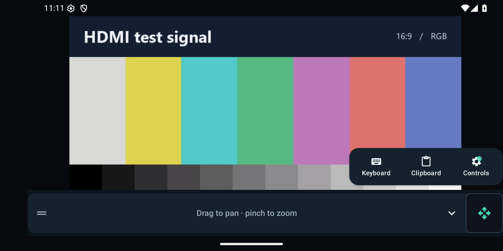
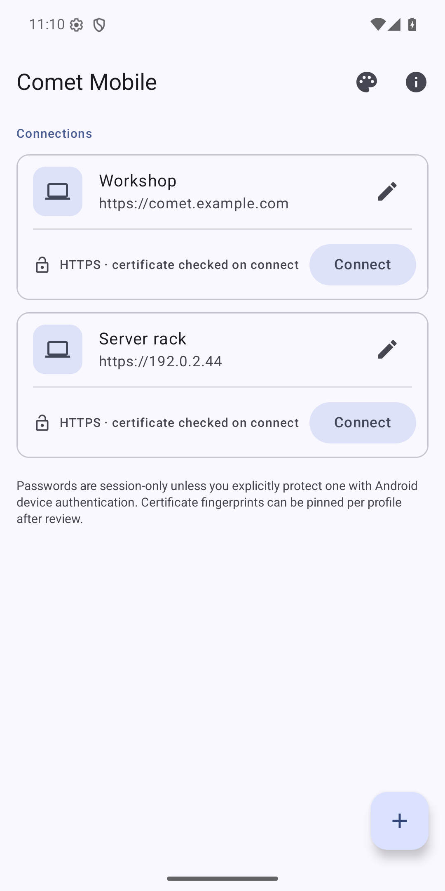
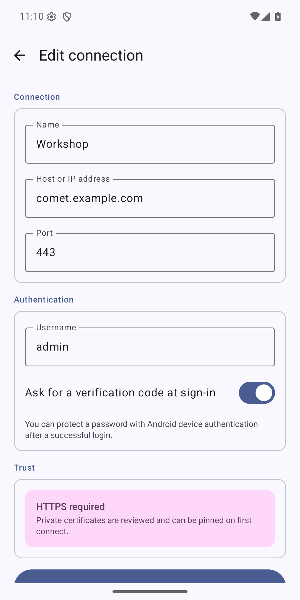

# Comet Mobile

Control a computer connected to a GL.iNet Comet GL-RM1 from an Android phone or tablet. Comet Mobile is an unofficial client for Android 8.0 and newer, targeting the original RM1 on stock firmware 1.10.3 release1. Connect over local HTTPS or an existing VPN.



## Connect

1. Choose **Add connection** and enter a name, the Comet hostname or IP address, HTTPS port and username. Turn on **Ask for a verification code at sign-in** if the appliance uses TOTP.
2. Choose **Connect**. Compare the displayed certificate fingerprint with the appliance through a trusted channel, then choose whether to remember it for this profile.
3. Enter the password. Saving it is optional and requires Android biometrics or the device screen lock. Enter a fresh six-digit code when prompted.

<table>
<tr>
<td width="50%" align="center"><br><strong>Saved connections</strong></td>
<td width="50%" align="center"><br><strong>Profile setup</strong></td>
</tr>
</table>

## Use the console

- **Display.** Direct H.264 carries the remote picture. Fit it to the screen, pinch to zoom, pan with the movable view pad, or enter immersive mode.
- **Pointer.** Use direct touch for absolute positioning or the relative trackpad for BIOS navigation. External mice support pointer capture on compatible Android devices. The scroll pad and external pointers support both wheel axes.
- **Keyboard.** Type with the Android keyboard or a physical keyboard. The console includes modifiers, function and navigation keys, Ctrl+Alt+Delete, and US and UK layouts.
- **Clipboard and shared text.** Preview and edit text before sending it to the displayed target. The app types confirmed text as keyboard input and uses Shift+Enter for line breaks.
- **Recovery.** The console distinguishes a missing HDMI signal, an expired login and an interrupted connection. Use **Release keys and mouse buttons** to release held keys and buttons.

## Build from source

Use JDK 21, the Android SDK platform 37 and the checked-in Gradle wrapper. Configure the SDK in Android Studio, through `ANDROID_HOME`, or with an untracked `local.properties`.

```shell
git clone https://github.com/andrewginns/comet-kvm-mobile.git
cd comet-kvm-mobile
./gradlew --dependency-verification=strict :app:assembleDebug
```

On Windows, use `.\gradlew.bat` in place of `./gradlew`. The local debug APK is written to `app/build/outputs/apk/debug/app-debug.apk`. Shareable Comet updates require their own verified signing identity. [Distribution and signing](docs/DISTRIBUTION.md) · [Testing](docs/TESTING.md)

## Project

Comet Mobile uses the Android application ID `org.cometkvm.mobile`. It is derived from [NanoKVM Mobile](https://github.com/andrewginns/nanokvm-mobile) and licensed under GPL-3.0-or-later. [Licence](LICENSE) · [Project notice](NOTICE) · [Third-party notices](THIRD_PARTY_NOTICES.md)

[Console plan](docs/COMET_CONSOLE_PLAN.md) · [Privacy](PRIVACY.md) · [Security](SECURITY.md) · [Contributing](CONTRIBUTING.md) · [Report an issue](https://github.com/andrewginns/comet-kvm-mobile/issues)
